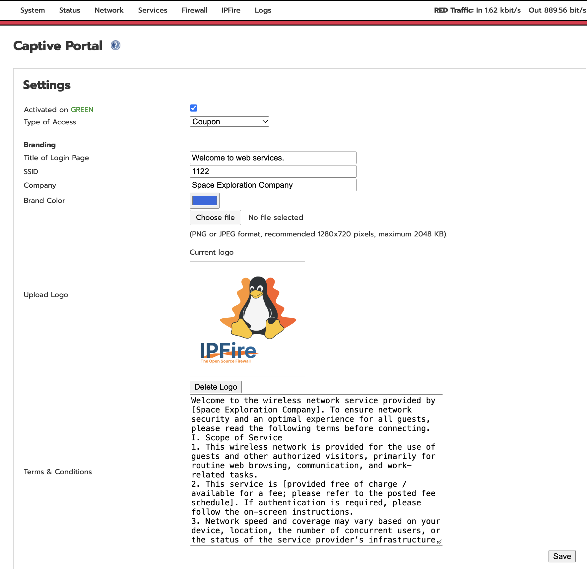
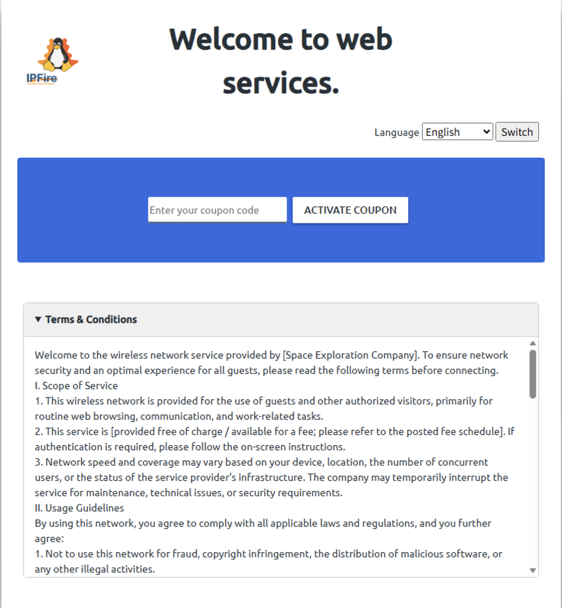
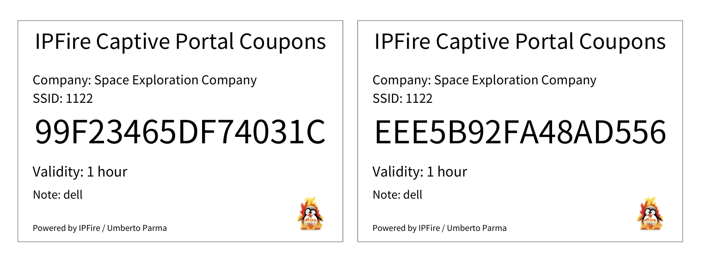

<div align="center">
  <a href="README.md">中文</a> |
  <a href="README_US.md">English</a>
</div>

# IPFire Captive Portal Enhanced

A community-maintained enhanced Captive Portal plugin for IPFire, featuring a Chinese interface, multilingual guest authentication, coupons, manual client authorization, custom branding, terms and conditions, and Chinese PDF export.

> Current version: **1.1.9**  
> Verified environment: **IPFire 2.29 Core Update 203, x86_64**  
> This is a community-maintained project and is not officially endorsed by IPFire. Test it in a non-production environment before using it with other Core Updates.



## Features

- Supports both **Terms & Conditions** and **Coupon** guest authentication modes.
- Allows administrators to authorize clients directly by IP address, MAC address, and duration without consuming a coupon.
- Provides a guest portal in 11 languages, with automatic browser-language detection and manual language switching.
- Makes the administration page follow the IPFire GUI language, while coupon and PDF languages can be selected independently.
- Supports PNG/JPEG brand logo uploads up to 2 MiB with instant preview.
- Provides a single Terms & Conditions editor displayed in a collapsible section on the guest portal.
- Generates secure 16-character hexadecimal coupon codes using a cryptographically secure random source.
- Supports Simplified and Traditional Chinese, extended Latin characters, and Cyrillic text in PDFs, with up to eight coupons per page.
- Redirects operating-system connectivity checks to `https://www.bing.com/` after successful authentication, while ordinary URLs return to their original destination.
- Uses IPFire's native `captivectrl` and `wirelessctrl` tools to apply rules; no additional daemon is installed.
- Automatically creates snapshots for installation, upgrades, and rollback.

## Screenshots

| Settings | Coupon management |
|---|---|
|  |  |

| Terms authentication | PDF export |
|---|---|
|  |  |

## Authentication Modes

| Feature | Description |
|---|---|
| Terms & Conditions | Grants access after the guest accepts the terms. The session duration is configured on the administration page. |
| Coupon | Grants access after the guest enters a valid, unused coupon code. The duration is taken from the coupon configuration. |
| Add Client | Directly authorizes a specified IP and MAC address. Available in both access modes. |

Coupon redemption and manual client authorization both write to the same authorized-client list. Coupons are single-use and are removed from the unused-coupon list immediately after successful redemption.

## Network Interface Behavior

- The installer automatically reads the target device's network configuration during installation or upgrade.
- `ENABLE_GREEN=on` is set by default when a GREEN interface exists.
- `ENABLE_BLUE=on` is set by default when a BLUE interface exists.
- Missing internal zones remain `off`; RED is never enabled as a Captive Portal interface.
- GREEN and BLUE can be enabled or disabled manually from the administration page. Submissions from older pages do not accidentally overwrite the current state.
- Only clients within enabled GREEN/BLUE subnets are accepted; gateway, network, and broadcast addresses are excluded.

The Captive Portal provides authentication and access control only. It does not isolate clients on the same Layer 2 network. Hotels, guest Wi-Fi deployments, and similar environments should still use AP client isolation or VLANs to prevent guest-to-guest access.

## Requirements

- IPFire 2.29. This release has been verified on Core Update 203 x86_64.
- The native IPFire Captive Portal must be installed, including `/usr/local/bin/captivectrl` and `/etc/httpd/conf/vhosts.d/captive.conf`.
- Perl modules: `CGI`, `HTML::Template`, `PDF::API2`, `File::LibMagic`, `JSON::PP`, and `Digest::SHA`.
- Bash, `flock`, `tar`, Apache administration commands, and `/usr/local/bin/update-lang-cache`.

## Installation

Copy the complete project directory to IPFire and run the installer as `root`:

```bash
cd captive-enhanced
bash install.sh
```

The installer checks the platform and syntax, backs up existing programs and portal data, installs the files, migrates legacy data, updates the language cache, validates the Apache configuration, and reloads the portal rules. If installation fails, it attempts to restore the snapshot created for that run.

The latest backup path is recorded in:

```text
/var/ipfire/captive-enhanced/last-backup
```

Backup directories use the following format:

```text
/var/backups/captive-enhanced/<date-time>-<PID>/
```

## Administration

Settings page:

```text
https://IPFire-address:444/cgi-bin/captive.cgi
```

## Basic Usage

### Terms & Conditions

1. Enable the required GREEN and/or BLUE interfaces.
2. Set the access type to **Terms & Conditions**.
3. Select the session duration.
4. Enter the welcome title, SSID, company name, and terms.
5. Save the settings and test from an unauthorized client connected to the selected network.

### Coupons

1. Set the access type to **Coupon** and save the settings.
2. In **Generate Coupons**, select the duration and quantity, and optionally enter a remark.
3. After generation, coupons can be viewed, deleted, or exported as a PDF.
4. A guest receives network access after entering an unused coupon code.

### Add Client

Enter the client's MAC address, IP address, allowed duration, and optional remark. The IP address must belong to an enabled GREEN/BLUE subnet, and the MAC address must be a valid unicast address. This function directly authorizes a client and does not require a coupon to be generated or consumed.

Before enabling the Captive Portal, add an unlimited authorization entry for the administration computer to avoid locking yourself out.

## Coupon PDF

- Uses the bundled Captive Sans CJK font under the SIL Open Font License 1.1.
- Includes up to eight coupons per page.
- Lays out the title, company, SSID, coupon code, duration, and remark within each card.
- Wraps long coupon codes without truncation.
- For compatibility with PDF::API2 2.033 on IPFire, fonts are fully embedded; a typical PDF is approximately 6 MiB.


## Logo Upload

- Supports PNG and JPEG files up to 2,097,152 bytes.
- Shows an immediate browser preview after a file is selected; the image is written to the system only after saving.
- Invalid or oversized files do not replace the current logo.
- The file-selection button and empty-state message follow the IPFire GUI language rather than the operating-system language.

## Upgrade and Data Migration

Use the same command for an upgrade as for the initial installation:

```bash
bash install.sh
```

The installer preserves existing settings, unused coupons, authorized clients, the logo, and the terms, and creates a new snapshot before overwriting any files.

If an older release contains a second terms file named `terms2.txt`, the upgrade appends it to `terms.txt` with two newline characters as a separator, then clears the old file. The administration and guest pages use one unified Terms & Conditions document. This migration is idempotent and does not append already migrated content again.

An IPFire Core Update may overwrite CGI files, cleanup programs, or Apache configuration. Keep both system and plugin backups before applying a Core Update, then recheck compatibility and install the adapted plugin release afterward.

## Rollback

Restore the state from immediately before the most recent installation:

```bash
bash uninstall.sh
```

Restore a specific snapshot:

```bash
bash uninstall.sh /var/backups/captive-enhanced/<date-time>-<PID>
```

Rollback restores the programs and Captive Portal data from the selected snapshot, then reloads Apache and the portal rules. Before restoring, the script saves the current portal data as `before-restore-*.tar.gz`.

## Testing

Current baseline results:

- 82 security and state tests passed.
- 43 language-resource tests passed.
- 10 logo front-end state tests passed.
- Installation scenarios for GREEN only, GREEN plus BLUE, and missing legacy configuration keys passed.
- Installation, rollback, Terms authentication, coupon redemption, manual client authorization, Windows redirect behavior, and Chinese PDF export were verified on a real Core Update 203 system.

BLUE/AP deployments, other Core Updates, and different hardware platforms should still be validated separately on the target device.

## Security Design

- Administration changes accept POST requests only and validate an HMAC form token bound to the administrator, source IP address, and expiry time.
- Guest addresses are taken only from Apache's `REMOTE_ADDR`; forwarded headers are not trusted.
- Coupon redemption verifies both the interface associated with the client IP address and the MAC address in the ARP table.
- Each guest IP address may submit no more than ten authentication attempts per ten minutes.
- Settings, coupons, and client records use shared locking and atomic replacement to prevent incomplete files during concurrent writes.
- Each coupon redemption uses a transaction journal that can be recovered on the next lock acquisition if the process is interrupted.
- Rule creation, removal, and expiry cleanup are handled by IPFire's native controllers.

These mechanisms are not a substitute for disk backups and do not guarantee transaction durability after sudden power loss or storage failure.

## Project Structure

```text
captive-enhanced/
├── install.sh                 # Installation and upgrade
├── uninstall.sh               # Rollback
├── src/                       # Files installed on IPFire
├── tests/                     # Security, language, CGI, front-end, and interface tests
├── image/                     # README screenshots
├── Manuale captive-zh-CN.md   # Detailed Chinese manual
├── Manuale captive-en.md      # Detailed English manual
├── MANIFEST.sha256            # Installation file checksums
└── VERSION
```

## Known Limitations

- Full hardware validation currently covers IPFire 2.29 Core Update 203 x86_64 only.
- The Captive Portal cannot isolate guest devices on the same Layer 2 network.
- Administrator-provided welcome titles, company names, and terms text are not translated automatically.
- The bundled font cannot guarantee coverage for every Unicode character or complex text layout.
- The anonymous PDF export URL can be accessed by anyone who can reach the administration address.

## License and Credits

The program is licensed under GPL-3.0-or-later and retains the copyright notices of IPFire and the original community authors.

The bundled fonts are based on Noto Sans SC and Noto Sans and are licensed under the SIL Open Font License 1.1. License and modification notices are located in `src/usr/share/fonts/captive-enhanced/`.

Thanks to the IPFire project, the original author **tratru**, and everyone who contributed testing and feedback.

## References

- [Official IPFire Captive Portal documentation](https://www.ipfire.org/docs/configuration/network/captive)
- [IPFire official website](https://www.ipfire.org/)
