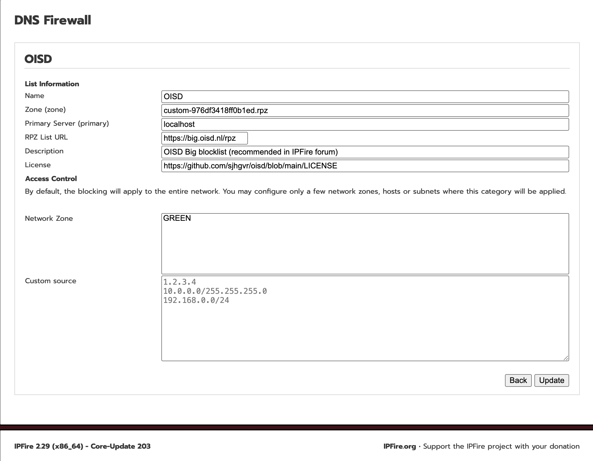

<div align="center">
  <a href="README.md">中文</a> |
  <a href="README.US.md">English</a>
</div>

# DNS Firewall Custom Lists for IPFire

<p>
  
  
</p>

> Plugin version: **1.1.5** · Target: **IPFire 2.29 Core Update 206 (x86_64)**

This plugin extends IPFire's native DNS Firewall page with user-managed HTTPS RPZ feeds while preserving the enable/disable and access-control behavior of official lists.



## Features

- Adds an **Add** button immediately to the left of **Save**.
- Adds, edits and deletes custom HTTPS RPZ feeds.
- Edits names, zones, primaries, URLs, descriptions, licenses and access control.
- Keeps official catalogue metadata read-only while allowing access-control changes.
- Stores custom entries separately in `/var/ipfire/dns/custom_dnsbl.json`.
- Uses HTTP `ETag` and `Last-Modified` conditional requests; unchanged feeds can return `304` without transferring the complete file.
- Rejects HTML responses and data without an SOA record, then replaces validated files atomically.
- Updates official and custom feeds through `/usr/local/bin/update-rpzs`, with one shared lock and one DNS reload.
- Provides English, Simplified Chinese and Traditional Chinese management interfaces.

## Installation

With the community repository configured, run as root:

```sh
ipfrepo update
ipfrepo install dns-firewall-custom-lists
```

For manual installation, copy the complete directory to IPFire and run as root:

```sh
cd dns-firewall-custom-lists
./install.sh
```

The installer checks Core 206 and required commands, validates script syntax, creates a timestamped backup under `/root`, installs files and language resources, prepares the shared lock and reloads DNS. Existing custom-list configuration is preserved. Core 206 does not depend on the legacy language-cache updater.

## Usage

Open `/cgi-bin/dnsbl.cgi` on the management interface.

1. Click **Add** and enter a name and HTTPS RPZ URL.
2. New lists are enabled by default and downloaded in the background.
3. Use the pencil icon to edit metadata or access control.
4. Select or clear a list and click **Save** to apply its state.
5. The delete icon appears only for custom lists and removes the entry, zone file and HTTP cache validators.

Example OISD configuration:

- Name: `OISD`
- URL: `https://big.oisd.nl/rpz`
- Description: `OISD Big blocklist`
- License: [OISD LICENSE](https://github.com/sjhgvr/oisd/blob/main/LICENSE)

## Update Mechanism

The native `dnsctrl sync-rpzs` action synchronizes enabled official zones through AXFR/IXFR, checks enabled custom feeds using conditional HTTPS requests, then reloads DNS once. The entire update holds `/var/ipfire/dns/rpz-update.lock`.

An unchanged `ETag` or `Last-Modified` value can produce `304 Not Modified`. Full download, validation and atomic replacement occur only after the feed changes. OISD does not provide AXFR/IXFR, so conditional HTTPS is used to check for updates.

Official and custom feeds share the same triggers: IPFire's `%hourly,random` fcron runs once at a randomized time each hour; saving list state or starting synchronization manually also triggers an update. Disabled custom lists are neither checked nor downloaded.

View logs:

```sh
grep update-rpzs /var/log/messages
```

Check for updates manually:

```sh
/usr/local/bin/dnsctrl sync-rpzs
```

## File Locations

| Purpose | Path |
| --- | --- |
| Management page | `/srv/web/ipfire/cgi-bin/dnsbl.cgi` |
| Updater | `/usr/local/bin/update-rpzs` |
| Custom lists | `/var/ipfire/dns/custom_dnsbl.json` |
| Update lock | `/var/ipfire/dns/rpz-update.lock` |
| Official restoration baseline | `/var/ipfire/dns/custom-lists-original/` |

## Uninstallation

For a repository installation:

```sh
ipfrepo remove dns-firewall-custom-lists
```

For a manual installation, run in the plugin directory:

```sh
./uninstall.sh
```

Uninstallation restores the official `dnsbl.cgi` and `update-rpzs` saved during the first installation and removes extension language resources, the lock and legacy scheduling files. Custom configuration and RPZ files are backed up to `/root/dns-firewall-custom-lists-uninstall-<timestamp>/` before removal.

## Validation Scope

On November 25, 2026, Core 206 upgrade, English/Simplified/Traditional pages, the add-list form, normal DNS resolution and a secure transfer of one official zone were verified.

The full RPZ batch encountered an upstream TLS connection reset and was not counted as passed. Official transfers use bounded concurrency and a 180-second batch deadline; failure does not clear existing rules.

## Notes

Feed content, availability and licensing remain the responsibility of each feed provider.

## Disclaimer

This is an unofficial community-maintained project with no affiliation to the IPFire team. Users are responsible for assessing and accepting the risks of use.
