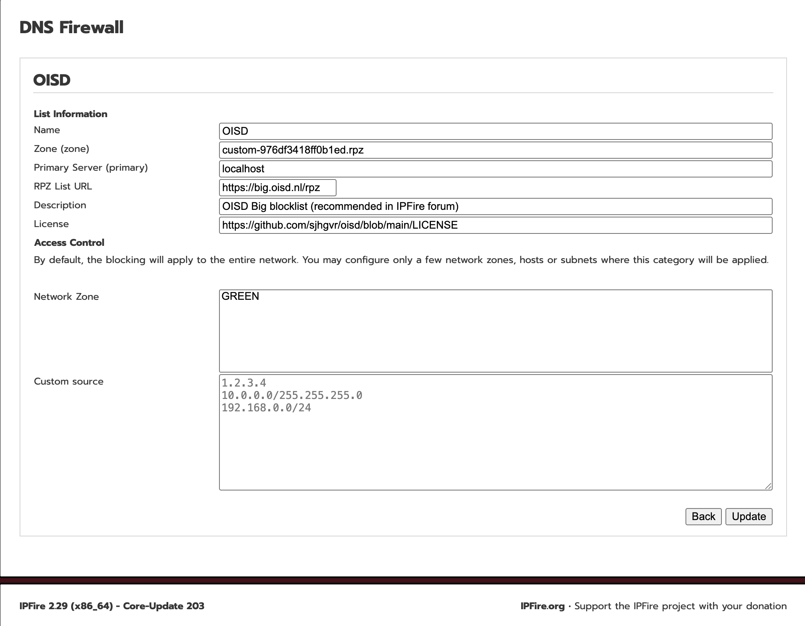

<div align="center">
  <a href="README.md">中文</a> |
  <a href="README.US.md">English</a>
</div>

# DNS Firewall Custom Lists for IPFire

<p>
  
  
</p>

> 插件版本：**1.1.5** · 适用系统：**IPFire 2.29 Core Update 206（x86_64）**

本插件扩展 IPFire 原生 DNS 防火墙页面，支持用户管理自定义 HTTPS RPZ 规则源，并保留官方列表的启停和访问控制行为。



## 功能

- 在“保存”按钮左侧添加“添加”按钮。
- 添加、编辑和删除自定义 HTTPS RPZ 规则源。
- 编辑名称、区域、主服务器、URL、描述、许可证和访问控制。
- 官方列表元数据保持只读，允许修改访问控制。
- 自定义条目单独保存在 `/var/ipfire/dns/custom_dnsbl.json`。
- 使用 HTTP `ETag` 和 `Last-Modified` 条件请求，内容未变时返回 `304`，无需重新传输完整规则。
- 拒绝 HTML 响应和不含 SOA 记录的数据，校验成功后原子替换文件。
- 官方和自定义规则由 `/usr/local/bin/update-rpzs` 统一更新，共用锁并统一重载 DNS。
- 管理界面支持英文、简体中文和繁体中文。

## 安装插件

已配置社区仓库时，以 root 执行：

```sh
ipfrepo update
ipfrepo install dns-firewall-custom-lists
```

手动安装时，将完整目录复制到 IPFire，以 root 执行：

```sh
cd dns-firewall-custom-lists
./install.sh
```

安装器检查 Core 206 和所需命令、校验脚本语法、在 `/root` 下创建带时间戳的备份，安装程序和语言资源、准备共享锁并重载 DNS。现有自定义列表配置会保留；Core 206 不依赖旧语言缓存程序。

## 使用

打开管理地址下的 `/cgi-bin/dnsbl.cgi`。

1. 点击“添加”，填写名称和 HTTPS RPZ 地址。
2. 新列表默认启用，并在后台下载。
3. 使用铅笔图标编辑元数据或访问控制。
4. 勾选或取消列表后，点击“保存”应用状态。
5. 删除图标仅对自定义列表显示，会移除条目、区域文件和 HTTP 缓存校验信息。

OISD 配置示例：

- 名称：`OISD`
- URL：`https://big.oisd.nl/rpz`
- 描述：`OISD Big blocklist`
- 许可证：[OISD LICENSE](https://github.com/sjhgvr/oisd/blob/main/LICENSE)

## 更新机制

IPFire 原生 `dnsctrl sync-rpzs` 会通过 AXFR/IXFR 同步启用的官方区域，并通过条件 HTTPS 请求检查启用的自定义规则，最后统一重载 DNS。整个更新过程持有 `/var/ipfire/dns/rpz-update.lock`。

服务器的 `ETag` 或 `Last-Modified` 未变时，可以返回 `304 Not Modified`；只有规则变化后才完整下载、校验并原子替换。OISD 不提供 AXFR/IXFR，因此使用条件 HTTPS 请求检查更新。

官方和自定义规则使用相同的更新触发方式：IPFire 的 `%hourly,random` fcron 每小时随机执行一次；保存列表状态或手动同步也会触发更新。禁用的自定义列表不会检查或下载。

查看日志：

```sh
grep update-rpzs /var/log/messages
```

手动检查更新：

```sh
/usr/local/bin/dnsctrl sync-rpzs
```

## 文件位置

| 用途 | 路径 |
| --- | --- |
| 管理页面 | `/srv/web/ipfire/cgi-bin/dnsbl.cgi` |
| 更新程序 | `/usr/local/bin/update-rpzs` |
| 自定义列表 | `/var/ipfire/dns/custom_dnsbl.json` |
| 更新锁 | `/var/ipfire/dns/rpz-update.lock` |
| 官方文件恢复基线 | `/var/ipfire/dns/custom-lists-original/` |

## 卸载插件

通过仓库安装时：

```sh
ipfrepo remove dns-firewall-custom-lists
```

手动安装时，在插件目录执行：

```sh
./uninstall.sh
```

卸载恢复首次安装保存的官方 `dnsbl.cgi` 和 `update-rpzs`，清理扩展语言资源、锁和旧计划任务。移除前，自定义配置和 RPZ 文件会备份到 `/root/dns-firewall-custom-lists-uninstall-<timestamp>/`。

## 验证范围

2026 年 11 月 25 日已验证 Core 206 升级、英简繁页面、添加列表表单、正常 DNS 解析和单个官方区域的安全传输。

完整 RPZ 批量更新遇到上游 TLS 连接重置，未计为通过。官方传输限制并发数，并设置 180 秒批次超时；失败不会清空现有规则。

## 注意事项

规则内容、可用性和许可证由对应规则提供者负责。

## 免责声明

这是社区维护的非官方项目，与 IPFire 团队没有隶属关系。使用者需自行评估并承担使用风险。
