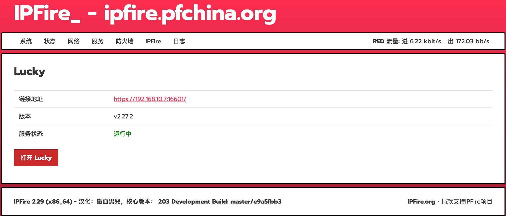

<div align="center">
  <a href="README.md">中文</a> |
  <a href="README.US.md">English</a>
</div>

# Lucky for IPFire

<p>
  
  
</p>

> Plugin version: **1.0.5** · Target: **IPFire 2.29 Core Update 206 (x86_64)**

This plugin integrates **Lucky** into the IPFire Web UI for graphical management.

Lucky is an all-in-one tool for home networks and routers, providing dynamic DNS (DDNS), ACME certificate management, port forwarding, web services and scheduled tasks.



## Features

- Port forwarding management.
- Web service hosting.
- Scheduled tasks.
- Service status monitoring.
- IPFire integration.
- Dynamic DNS management.
- Automatic ACME certificate issuance and renewal.

## Upstream Version

Upstream release: [Lucky v2.27.2](https://github.com/gdy666/lucky/releases/tag/v2.27.2).

Bundled archive: `lucky_2.27.2_Linux_x86_64.tar.gz`.

## Installation

Copy the plugin directory to IPFire and run as root:

```sh
sh install.sh
```

## Access

After installation, open:

```text
Services > Lucky
```

Default address:

```text
https://IPFire-address:16601/
```

Default credentials:

```text
Username: 666
Password: 666
```

Change the default password after the first login and configure a secure access path.

## Uninstallation

```sh
sh uninstall.sh
```

## Compatibility

| IPFire version | Architecture | Status |
| --- | --- | --- |
| 2.29 Core 206 | x86_64 | Isolated compatibility checks passed |

## Disclaimer

This is an unofficial community project with no affiliation to the IPFire team. You are responsible for its use and any resulting risks.
