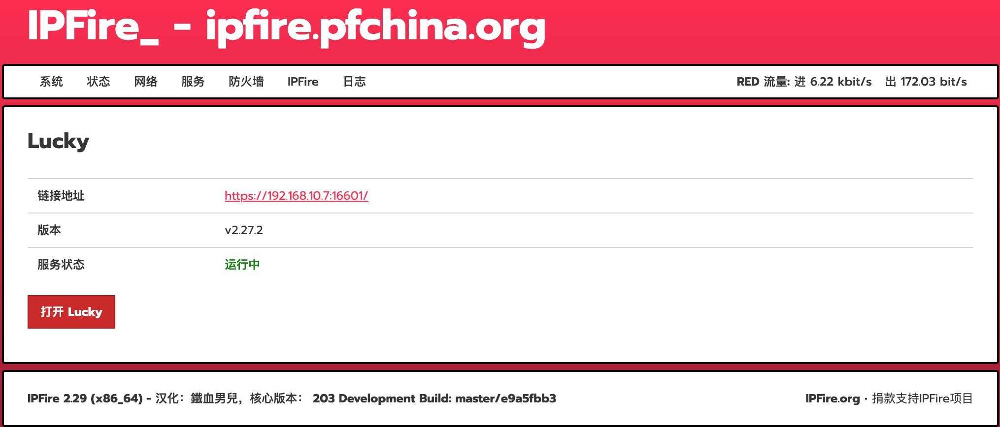

<div align="center">
  <a href="README.md">中文</a> |
  <a href="README.US.md">English</a>
</div>

# Lucky for IPFire

<p>
  
  
</p>

> 插件版本：**1.0.5** · 适用系统：**IPFire 2.29 Core Update 206（x86_64）**

本项目将 **Lucky** 集成到 IPFire WebUI 中，为用户提供便捷的图形化管理界面。

Lucky 是一款面向家庭网络和路由器场景的一体化管理工具，提供动态域名解析（DDNS）、ACME 证书管理、端口转发、Web 服务、计划任务等丰富功能。



## 功能

- 端口转发管理
- Web 服务托管
- 计划任务管理
- 服务状态监控
- IPFire无缝集成
- 动态域名解析管理
- ACME证书自动申请与续期

## 上游版本

上游发布版本：
https://github.com/gdy666/lucky/releases/tag/v2.27.2
内置安装包：
lucky_2.27.2_Linux_x86_64.tar.gz

## 安装插件

将项目目录复制到 IPFire 系统后，以 root 用户执行：

```bash
sh install.sh
```

## 访问

安装完成后，在 IPFire WebUI 中访问：

```text
服务 → Lucky
```

默认访问地址：

```text
https://IPFire-address:16601/
```
默认登录信息：

```text
用户名：666
密码：666
```
> ⚠️ 首次登录后请立即修改默认密码，并配置安全的访问路径。

## 卸载插件

```bash
sh uninstall.sh
```

## 兼容性

| IPFire 版本 | 架构 | 状态 |
|------------|------|------|
| 2.29 Core 206 | x86_64 | 隔离兼容检查通过 |

## 免责声明

这是一个非官方社区项目，与 IPFire 团队没有任何关联，自行承担使用过程中可能产生的风险。
