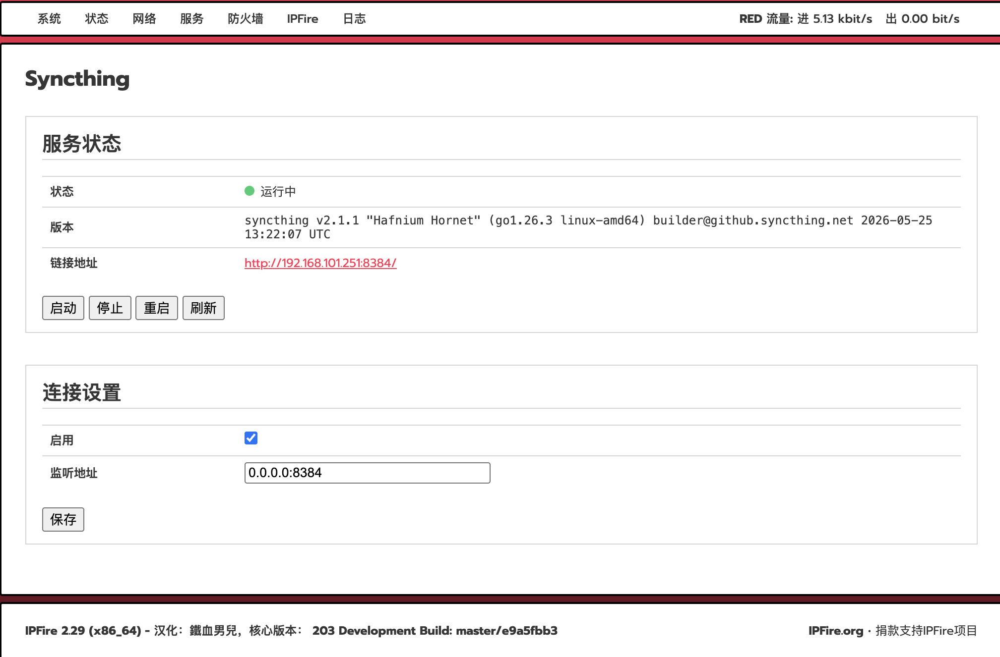

<div align="center">
  <a href="README.md">中文</a> |
  <a href="README.US.md">English</a>
</div>

# Syncthing for IPFire

<p>
  
  
</p>

> Plugin version: **1.0.5** · Target: **IPFire 2.29 Core Update 206 (x86_64)**

Syncthing is a free, open-source continuous file synchronization tool. It synchronizes files directly between devices without a central cloud server, using encrypted connections. Syncthing supports Windows, macOS, Linux and other platforms for self-hosted, peer-to-peer synchronization across computers and networks.

This plugin installs Syncthing on IPFire and integrates its management into the firewall interface.

## Features

- Simple installation and removal.
- Native IPFire integration.
- Browser-based Syncthing management.

## Screenshots



## Installation

```sh
sh install.sh
```

After installation, open **Services > Syncthing**.

## Uninstallation

```sh
sh uninstall.sh
```

## Disclaimer

This is an unofficial community project with no affiliation to the IPFire team. You are responsible for its use and any resulting risks.
