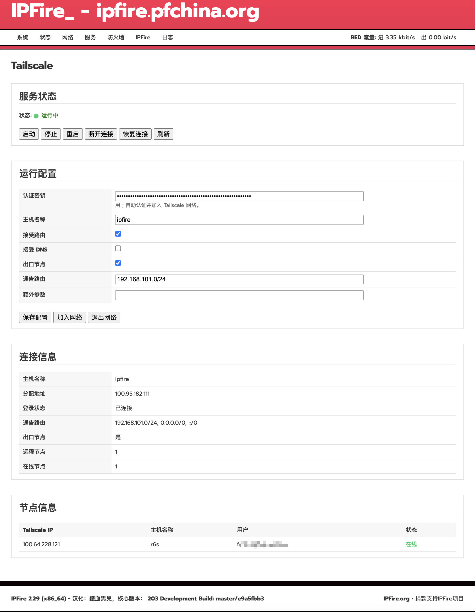

<div align="center">
  <a href="README.md">中文</a> |
  <a href="README.US.md">English</a>
</div>

# Tailscale for IPFire

<p>
  
  
</p>

> Plugin version: **1.0.5** · Target: **IPFire 2.29 Core Update 206 (x86_64)**

Tailscale for IPFire provides a native Web management interface for configuring and managing Tailscale from the IPFire administration interface.



## Features

- Native IPFire Web UI integration.
- Join a Tailscale network using an authentication key.
- Set a custom hostname.
- Configure subnet routes and exit nodes.
- Detect the platform architecture and download official static Tailscale binaries.
- English, Simplified Chinese and Traditional Chinese interfaces, with English fallback for other languages.

## Supported Platform

| Platform | Version |
| --- | --- |
| IPFire | 2.29 Core Update 206 |
| Architecture | x86_64 / amd64 |

## Installation

```sh
sh install.sh
```

## Uninstallation

```sh
sh uninstall.sh
```

## Configuration

After installation, open:

```text
Services > Tailscale
```

Start the service, enter an authentication key and configure the following options as needed:

- Hostname.
- Accept routes.
- Advertise routes.
- Exit node.

Save the options, then click **Join Network**.

After joining:

1. Open the Tailscale administration console.
2. Select the IPFire device.
3. Disable key expiry or approve advertised routes and exit-node use as appropriate.

## Tailscale Binaries

The installer downloads official static binaries from [Tailscale packages](https://pkgs.tailscale.com/stable/#static).

## Notes

- The plugin settings page uses authentication keys for automated deployment.
- Advertised routes and exit-node use require manual approval in the Tailscale administration console.
- DNS takeover is disabled by default (`--accept-dns=false`) to avoid overriding IPFire's local DNS configuration.

## Disclaimer

This is an unofficial community project with no affiliation to the IPFire team. You are responsible for its use and any resulting risks.
