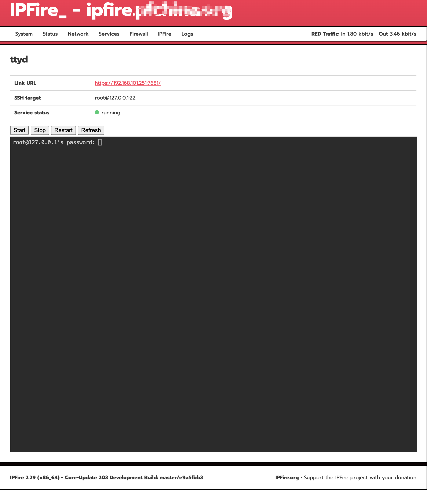

<div align="center">
  <a href="README.md">中文</a> |
  <a href="README.US.md">English</a>
</div>

# ttyd for IPFire

<p>
  
  
</p>

> Plugin version: **1.0.5** · Target: **IPFire 2.29 Core Update 206 (x86_64)**

This community plugin integrates ttyd into the IPFire management interface, providing an interactive browser terminal for system administration and troubleshooting. The terminal connects to a host over SSH; the default target is IPFire itself.

## Features

- Adds a terminal page under **Services > ttyd**.
- Provides Start, Stop, Restart and Refresh controls, with service status and the SSH target.
- Registers ttyd under **Status > Services** for service and boot autostart control.
- Provides a writable terminal over HTTPS and WebSocket.
- Automatically reads the IPFire Web UI certificate, or uses a specified certificate and private key.
- Supports configurable listen address, port and SSH target.
- Leaves the service stopped and boot autostart disabled after installation, ready for manual activation.



## Installation

### Community Repository

With the community repository and `ipfrepo` configured, run as root:

```sh
ipfrepo update
ipfrepo install ttyd
```

### Manual Installation

Download and extract the plugin archive, enter the `ttyd` directory containing `install.sh` and `src`, and run as root:

```sh
sh install.sh
```

The installer copies the program and configuration, registers the service, configures Web service-control permissions and adjusts the Web UI Content Security Policy (CSP) to allow embedding the HTTPS terminal on its default port.

Installation or reinstallation stops the existing ttyd service, copies the bundled configuration and disables boot autostart. Back up any custom configuration first.

## Usage

1. Enable SSH in IPFire and verify the configured SSH port.
2. Open **Services > ttyd** and click **Start**.
3. Follow the SSH authentication prompts in the terminal. The default account is the local root account.
4. Click the terminal link to open a separate window if needed.
5. Click **Stop** when you want to shut down the terminal service.

The default terminal address is `https://<IPFire-management-address>:7681/`. Your browser must be able to reach that address and port. Signing in to the IPFire Web UI does not replace SSH authentication inside the terminal.

To enable boot autostart, change ttyd's startup setting under **Status > Services**.

## Configuration

Configuration file: `/etc/sysconfig/ttyd`. Restart ttyd after making changes.

| Setting | Default | Description |
| --- | --- | --- |
| `TTYD_ENABLE` | `yes` | Allows service startup; separate from boot autostart |
| `TTYD_INTERFACE` | `0.0.0.0` | Listens on all IPv4 addresses; can be set to a management address |
| `TTYD_PORT` | `7681` | HTTPS terminal port |
| `TTYD_BASE_PATH` | `/` | Terminal URL base path |
| `TTYD_SSL_CERT` | Empty | Automatically finds the Web UI certificate when empty |
| `TTYD_SSL_KEY` | Empty | Automatically finds the corresponding private key when empty |
| `TTYD_SSH_USER` | `root` | SSH username |
| `TTYD_SSH_HOST` | `127.0.0.1` | SSH target host |
| `TTYD_SSH_PORT` | `22` | SSH target port; must match the actual SSH service |

For example, if local SSH listens on port 222, set `TTYD_SSH_PORT` to `222`.

The configuration is read by a shell; keep the variable-assignment format. The current SSH invocation uses password or keyboard-interactive authentication and disables public-key authentication.

If you change the terminal port or base path, also check the generated page link and the Web UI CSP. The installer's embedding permission targets the default HTTPS port 7681.

## Command-Line Management

```sh
/etc/rc.d/init.d/ttyd start
/etc/rc.d/init.d/ttyd stop
/etc/rc.d/init.d/ttyd restart
/etc/rc.d/init.d/ttyd status
```

| Purpose | Path |
| --- | --- |
| ttyd binary | `/opt/ttyd/bin/ttyd` |
| Management page | `/srv/web/ipfire/cgi-bin/ttyd.cgi` |
| Service configuration | `/etc/sysconfig/ttyd` |
| Runtime log | `/var/log/ttyd.log` |
| PID file | `/run/ttyd.pid` |
| SSH host-key records | `/opt/ttyd/known_hosts` |

## Troubleshooting

**The service will not start:** Check the log. Confirm that the ttyd binary exists and is executable, SSH is running, and the HTTPS certificate and private key are readable. Set `TTYD_ENABLE` to `yes`.

**SSH connection fails inside the terminal:** Check the target host, port and account. The default SSH port is 22; the plugin does not automatically detect a different device SSH port.

**The service is running but the embedded terminal is blank:** Open the standalone terminal link first and check certificate trust and port connectivity, then check browser WebSocket connections and CSP restrictions.

**Remote access to the Web UI works but the terminal does not:** The terminal uses a separate port, 7681, which requires its own reachable access path. If the Web UI uses port forwarding, handle the terminal port separately and restrict it to trusted management sources.

## Uninstallation

Run as root in the plugin installation directory:

```sh
sh uninstall.sh
```

Uninstallation stops the service and removes the program, configuration, page, service registration, logs, SSH host-key records and plugin language adapter. Back up any configuration or logs you want to keep first.

The uninstaller prefers restoring the Web server configuration backup saved during installation. If you changed that configuration afterward, compare the backup with the current file before uninstalling.

## Validation Scope

On November 25, 2026, isolated syntax, translation-resource and initial English/Simplified/Traditional CGI page checks passed in a Core 206 x86_64 environment. Live browser-terminal connections, reboot and complete installation/uninstallation regression were not repeated in this run.

## Project Information

This is an unofficial community-maintained IPFire plugin. Upstream ttyd project: [tsl0922/ttyd](https://github.com/tsl0922/ttyd).

## Disclaimer

This is an unofficial community-maintained project with no affiliation to the IPFire team. Users are responsible for assessing and accepting the risks of use.
