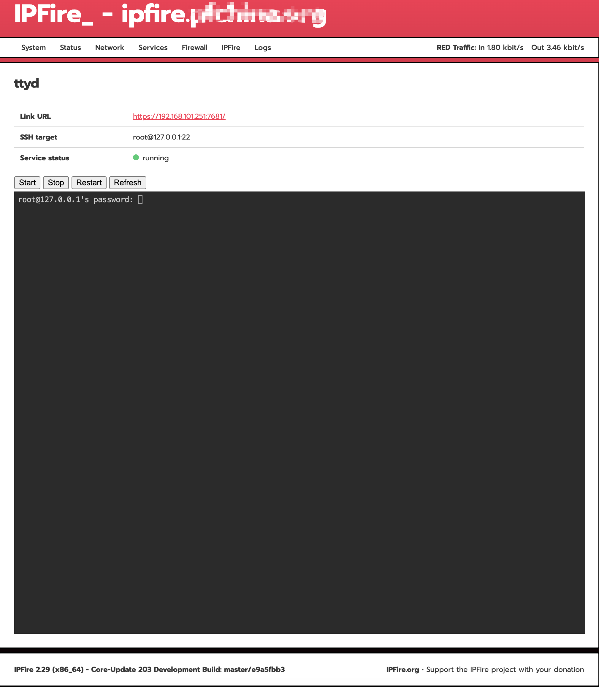

<div align="center">
  <a href="README.md">中文</a> |
  <a href="README.US.md">English</a>
</div>

# ttyd for IPFire

<p>
  
  
</p>

> 插件版本：**1.0.5** · 适用系统：**IPFire 2.29 Core Update 206（x86_64）**

插件版本：**1.0.5**

适用系统：**IPFire 2.29 Core Update 206，x86_64**

本社区插件将 ttyd 集成到 IPFire 管理界面，通过浏览器打开交互式终端，便于执行系统管理和故障排查命令。终端通过 SSH 连接目标主机，默认目标是 IPFire 本机。

## 功能

- 在 **服务 > ttyd** 中显示终端页面。
- 提供启动、停止、重启和刷新按钮，显示运行状态和 SSH 目标。
- 将 ttyd 注册到 **状态 > 服务**，支持服务控制及开机启动设置。
- 使用 HTTPS 和 WebSocket 提供可输入命令的终端。
- 自动读取 IPFire Web 管理界面的证书，也可指定证书和私钥。
- 支持设置监听地址、端口及 SSH 目标。
- 安装后默认停止运行，并关闭开机启动，需要时手动开启。



## 安装插件

### 从社区仓库安装

已配置 IPFire 社区仓库及 `ipfrepo` 的设备，以 root 身份执行：

```sh
ipfrepo update
ipfrepo install ttyd
```

### 手动安装

下载并解压插件安装包，进入包含 `install.sh` 和 `src` 的 `ttyd` 目录，以 root 身份执行：

```sh
sh install.sh
```

安装程序会复制程序及配置、注册服务、配置 Web 服务控制权限，并调整 Web 管理界面的 CSP，以允许嵌入默认端口上的 HTTPS 终端。

安装或重新安装会停止已有 ttyd 服务、复制随包配置，并将开机启动设为关闭。已有自定义配置请先备份。

## 使用

1. 在 IPFire 中启用 SSH 服务，确认配置的 SSH 端口正确。
2. 打开 **服务 > ttyd**，点击“启动”。
3. 在页面内的终端中，根据 SSH 提示完成认证，默认使用本机 root 账户。
4. 需要独立窗口时，点击页面显示的终端链接。
5. 使用完毕后，可以点击“停止”关闭终端服务。

默认终端地址为 `https://<IPFire管理地址>:7681/`。浏览器须能访问该地址和端口；IPFire Web 管理页面的登录状态不会代替终端中的 SSH 认证。

如需开机启动，在 **状态 > 服务** 中设置 ttyd 的启动选项。

## 配置

配置文件：`/etc/sysconfig/ttyd`。修改后重启 ttyd 生效。

| 配置项 | 默认值 | 说明 |
| --- | --- | --- |
| `TTYD_ENABLE` | `yes` | 是否允许服务启动；与开机启动设置分别控制 |
| `TTYD_INTERFACE` | `0.0.0.0` | 监听全部 IPv4 地址，可改为指定管理地址 |
| `TTYD_PORT` | `7681` | HTTPS 终端端口 |
| `TTYD_BASE_PATH` | `/` | 终端 URL 的基础路径 |
| `TTYD_SSL_CERT` | 空 | 留空时自动寻找 Web 管理界面的证书 |
| `TTYD_SSL_KEY` | 空 | 留空时自动寻找对应私钥 |
| `TTYD_SSH_USER` | `root` | SSH 登录用户名 |
| `TTYD_SSH_HOST` | `127.0.0.1` | SSH 目标主机 |
| `TTYD_SSH_PORT` | `22` | SSH 目标端口，需与 SSH 服务实际设置一致 |

例如，本机 SSH 使用 222 端口时，将 `TTYD_SSH_PORT` 改为 `222`。

配置文件由 shell 读取，应保留变量赋值格式。当前 SSH 调用使用密码或键盘交互认证，关闭公钥认证。

如果修改终端端口或基础路径，还需核对页面生成的链接及 Web 管理界面的 CSP；安装程序中的嵌入许可针对默认 HTTPS 端口 7681。

## 命令行管理

```sh
/etc/rc.d/init.d/ttyd start
/etc/rc.d/init.d/ttyd stop
/etc/rc.d/init.d/ttyd restart
/etc/rc.d/init.d/ttyd status
```

| 用途 | 路径 |
| --- | --- |
| ttyd 程序 | `/opt/ttyd/bin/ttyd` |
| 管理页面 | `/srv/web/ipfire/cgi-bin/ttyd.cgi` |
| 服务配置 | `/etc/sysconfig/ttyd` |
| 运行日志 | `/var/log/ttyd.log` |
| PID 文件 | `/run/ttyd.pid` |
| SSH 主机密钥记录 | `/opt/ttyd/known_hosts` |

## 常见问题

**服务无法启动**：检查日志，确认 ttyd 程序存在且可执行、SSH 服务正在运行，并且 HTTPS 证书和私钥可读取。`TTYD_ENABLE` 应设为 `yes`。

**终端出现 SSH 连接失败**：检查目标主机、端口和账户。默认 SSH 端口为 22，插件不会自动匹配设备另行设置的端口。

**服务已运行，页面内终端空白**：先打开页面中的独立终端链接，检查证书信任和端口连通性，再检查浏览器的 WebSocket 连接及 CSP 限制。

**远程访问管理页面正常，但终端打不开**：终端使用独立的 7681 端口，需要对应的访问路径。如果管理页面经过端口转发，终端端口也需要单独处理，并限制到可信管理来源。

## 卸载插件

在插件安装目录中，以 root 身份执行：

```sh
sh uninstall.sh
```

卸载会停止服务，删除程序、配置、页面、服务注册、日志和 SSH 主机密钥记录，并清理本插件的语言适配文件。需要保留的配置和日志请先备份。

卸载脚本会优先恢复安装时保存的 Web 服务配置备份；如果安装后另行修改了这些配置，卸载前应核对备份与现有文件。

## 验证范围

2026 年 11 月 25 日已完成 Core 206 x86_64 环境下的隔离语法检查、翻译资源检查和英、简、繁初始 CGI 页面检查。本轮未重新完成浏览器终端实际连接、设备重启，以及完整安装和卸载回归测试。

## 项目说明

这是社区维护的非官方 IPFire 插件。ttyd 上游项目：[tsl0922/ttyd](https://github.com/tsl0922/ttyd)。

## 免责声明

这是社区维护的非官方项目，与 IPFire 团队没有隶属关系。使用者需自行评估并承担使用风险。
