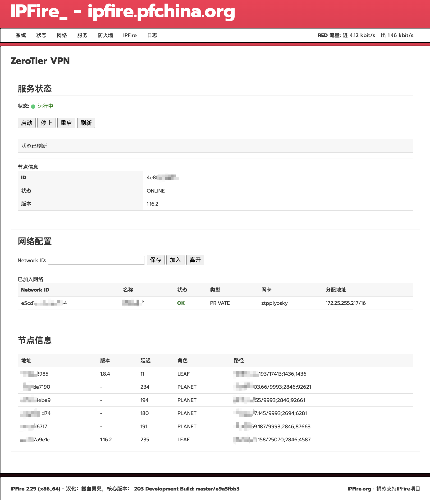

<div align="center">
  <a href="README.md">中文</a> |
  <a href="README.US.md">English</a>
</div>

# ZeroTier for IPFire

<p>
  
  
</p>

> Plugin version: **1.0.5** · Target: **IPFire 2.29 Core Update 206 (x86_64)**

This plugin adds a ZeroTier VPN management page to the IPFire Web UI.



## Installation

Run as root on IPFire:

```sh
bash install.sh
```

After installation, open:

```text
Services > ZeroTier VPN
```

## Uninstallation

```sh
bash uninstall.sh
```

## Configuration File

The default configuration file is:

```text
/var/ipfire/zerotier/settings
```

The setting:

```text
ALLOW_DEFAULT=on
```

allows a ZeroTier-managed default route.

Keep this option disabled unless you intend to route all internet traffic through the ZeroTier network.

## Joining a Network

1. Click **Start**.
2. Enter the Network ID.
3. Click **Save**.
4. Click **Join**.
5. Authorize the node in the ZeroTier controller.

After authorization, the device can join the ZeroTier network.

## Disclaimer

This is an unofficial community project with no affiliation to the IPFire team. You are responsible for its use and any resulting risks.
